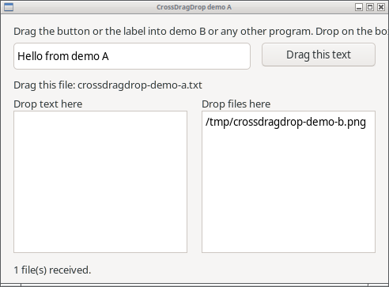
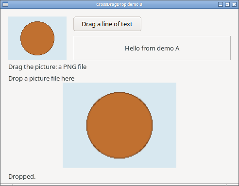

# CrossDragDrop

Native drag and drop for existing Lazarus controls. Two nonvisual
components: point one at a control, handle one event.

**Status: tested on Linux with GTK2 and GTK3 on X11, GTK3 on native
Wayland, and Qt5 on X11 and native Wayland, and on Windows 10 (64-bit,
Win32 widgetset). macOS is the next backend; it compiles today and
reports that drag and drop is not available.**

| Platform | Two programs: text, files, clicks, cancel | Fade and highlight | Lifetime check | Other programs |
|---|---|---|---|---|
| Linux GTK3, X11 | ✅ | ✅ | ✅ | not yet |
| Linux GTK2, X11 | ✅ | ✅ | ✅ | not yet |
| Linux GTK3, native Wayland (KDE) | ✅ | ✅ | not run | not yet |
| Linux Qt5, X11 | ✅ | ✅ | ✅ | not yet |
| Linux Qt5, native Wayland (KDE) | ✅ | ✅ | ✅ | not yet |
| Windows 10 x86_64, Win32 | ✅ | ✅ | ✅ | ✅ Explorer, WordPad |
| Windows 32-bit | not built | | | |
| Linux Qt6 | not built | | | |
| macOS Cocoa | builds, reports not available | | | |

"Two programs" is the test probe: two separate processes, a plain click,
a press below the drag threshold, Unicode text, two files with spaces,
`%`, `#` and accented names, a fallback to text, a drop the target refuses
and Escape, all checked against both programs' event logs. Details per
platform are in the [platform matrix](docs/PLATFORMS.md).

```pascal
// Drop a TCrossDragDropSource on the form, set Control to Button1 and
// write this handler. Dragging the button now carries the text.
procedure TForm1.Source1GetText(Sender: TObject; out AText: string);
begin
  AText := Edit1.Text;
end;

// Drop a TCrossDragDropTarget, set Control to Memo1 and write this one.
// Text dropped from any program lands here.
procedure TForm1.Target1DropText(Sender: TObject; const AText: string; X, Y: integer);
begin
  Memo1.Lines.Add(AText);
end;
```

A source offers UTF-8 text in OnGetText, existing files in OnGetFiles, or
both; the receiver picks. Leave the text empty and the list empty, and no
drag starts. A target takes text in OnDropText and files in
OnDropFiles, as full paths. The control can be anything: a button, a label,
an image, a panel, a list box. A label or an image works through its parent.
The data is whatever the program hands over; the control itself is not
transferred. Copy is the only operation.

While a drag is in progress the source control fades under a dashed
outline and a snapshot of it travels under the pointer. A target that would
take the drop gets a frame in the desktop highlight color; a target that
would not stays as it is, and so does the cursor. Fade, Highlight and
HighlightColor turn these off or recolor them. An ordinary click on a
source button still clicks; a drag beyond the desktop's threshold does not.

OnDragEnd reports whether the data was dropped, canceled, rejected or
failed. OnDragOver can refuse an offer by position or format before the
drop. RejectDrop inside a drop event tells the other program the data was
not used. OnError reports a second helper on the same control, a bad file
list or a widgetset without support; nothing shows a dialog.

* [Implementation roadmap](ROADMAP.md)
* [Platform matrix](docs/PLATFORMS.md)
* [Reference documentation](docs/REFERENCES.md)

## Demos

`demo/a` and `demo/b` are two separate programs. Run both and drag between
them: a button that carries an edit box's text, a label that carries a
file, a picture that is offered as a PNG file, a button with a line of
text, and targets in a memo, a list box, a panel and a picture box. The
picture box refuses a file that is not an image, and both sides say so.

| Demo A | Demo B |
|---|---|
|  |  |

## Install

Open `crossdragdrop.lpk` in Lazarus, compile and install. The components
are on the System page. The package needs only the LCL; the GTK and Qt
backends use the libraries the LCL already loads, and the Windows backend
uses the system's OLE drag and drop. Test automation uses
LazHIDControl's hidctl, which is not a runtime dependency.

## What differs between desktops

* Qt cannot tell a canceled drag from a rejected one: OnDragEnd reports
  Rejected for both. GTK on Wayland reports Failed for a cancel.
* On Wayland, GTK takes the highlight off a target before OnDropText or
  OnDropFiles runs; on X11 and Qt it is still on during the event.
* On Qt the fade and the highlight are drawn by a see-through label laid
  over the control; it never takes mouse or drop events. A control that
  is both a source and a target gets one for each.
* Whether the snapshot of the control appears under the pointer on
  Wayland depends on the compositor.
* Windows tells a canceled drag (Escape) from a rejected one, like X11.
  Text goes out as Unicode text and files as a file list (CF_HDROP), the
  formats Explorer, WordPad and most programs use; a target also reads the
  ANSI text of older programs. Files from a network share arrive as
  `\\server\share\...` paths.
* On Windows a target registers its control's window with OLE. A window
  that other code in the program already registered for drops is refused
  with an error.

## Origin

The simple control assignment and data-event experience is inspired by
Bernd Kreuss's [NativeDragDrop](https://github.com/prof7bit/NativeDragDrop).
CrossDragDrop is a new implementation. No source from that project has
been included in this repository.

## License

[0BSD](LICENSE). Copyright (c) 2026 Tony Stone.
